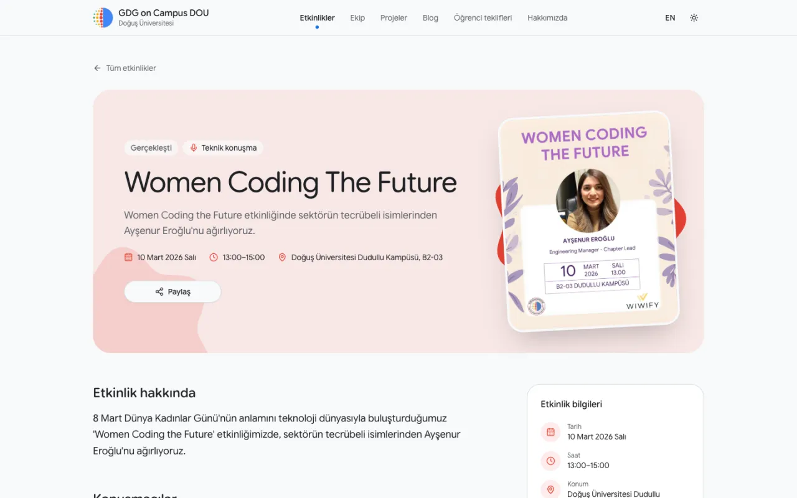
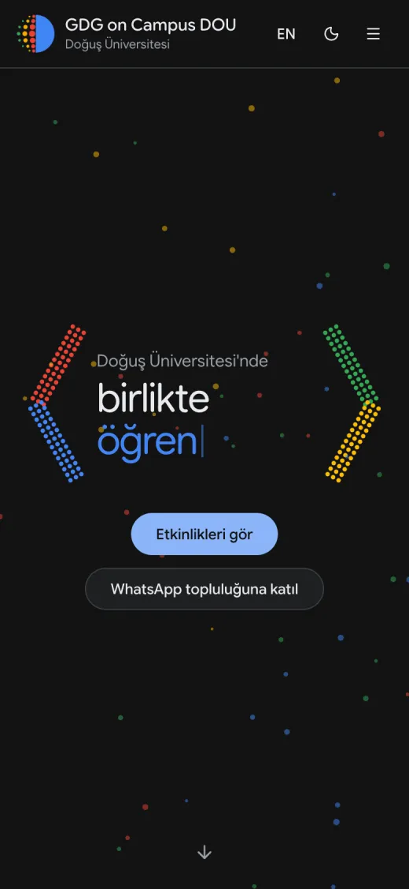
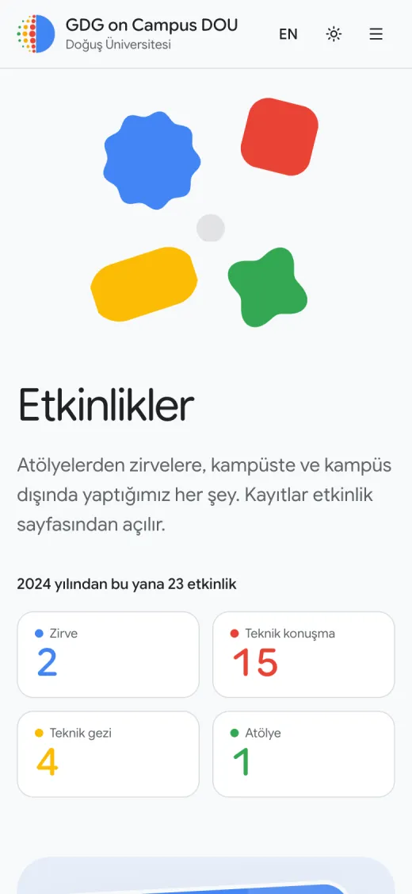
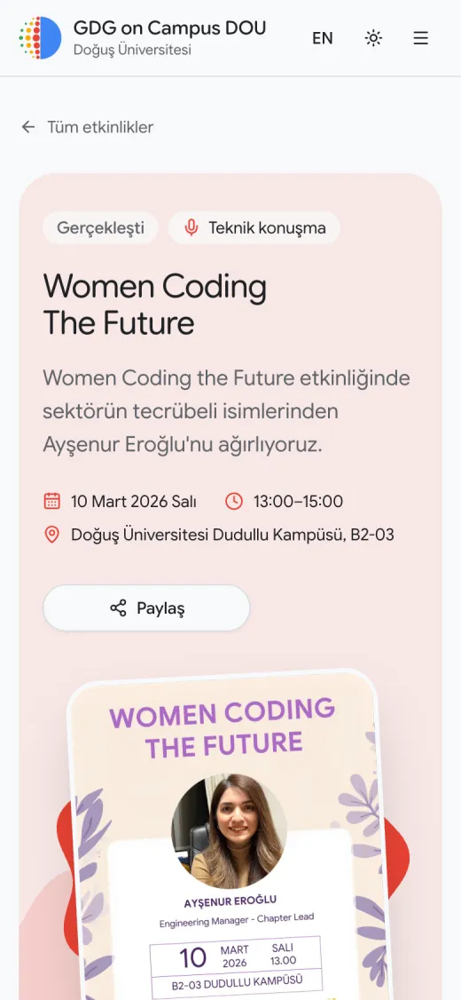
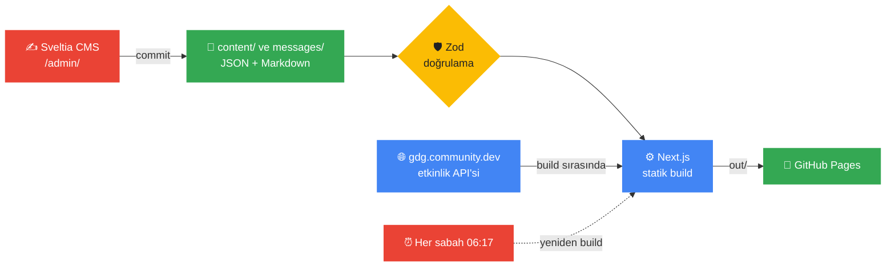

<div align="center">

<picture>
  <source media="(prefers-color-scheme: dark)" srcset=".github/assets/banner-dark.svg">
  
</picture>

<br>

[](https://nextjs.org)
[](https://react.dev)
[](https://www.typescriptlang.org)
[](https://tailwindcss.com)
[](https://pages.github.com)
[](LICENSE)

**[gdgoncampusdou.com.tr](https://gdgoncampusdou.com.tr)** ·
[Etkinlikler](https://gdgoncampusdou.com.tr/tr/events/) ·
[Katkı rehberi](CONTRIBUTING.md) ·
[WhatsApp topluluğu](https://chat.whatsapp.com/JL2FcOdXFxgGb72P6BxvP9)

</div>

Doğuş Üniversitesi **Google Developer Groups on Campus** topluluğunun web sitesi. Etkinlikleri,
ekipleri, projeleri, blog yazılarını ve öğrencilere özel teklifleri tek yerde toplar. İki dillidir
(TR/EN), sunucusuz çalışır ve GitHub Pages'te yayınlanır.

*The website of Google Developer Groups on Campus at Doğuş University. Bilingual (TR/EN),
statically exported with Next.js and hosted on GitHub Pages. Events are pulled from
gdg.community.dev at build time and the site rebuilds itself every morning.*

## İçindekiler

- [Öne çıkanlar](#öne-çıkanlar)
- [Ekran görüntüleri](#ekran-görüntüleri)
- [Nasıl çalışıyor?](#nasıl-çalışıyor)
- [Kullanılan teknolojiler](#kullanılan-teknolojiler)
- [Kurulum](#kurulum)
- [Komutlar](#komutlar)
- [Proje yapısı](#proje-yapısı)
- [İçerik yönetimi (CMS)](#i̇çerik-yönetimi-cms)
- [Yayın (deploy)](#yayın-deploy)
- [Katkı](#katkı)

## Öne çıkanlar

| | |
|---|---|
| 🌍 **İki dil** | Her sayfa `/tr` ve `/en` altında. Arayüz metinleri ve içerikler iki dilde tutulur. |
| 🌗 **Açık ve koyu tema** | Sistem ayarını izler; üst menüden elle de değiştirilebilir. |
| 📅 **Kendiliğinden güncel etkinlikler** | Etkinlikler gdg.community.dev'den çekilir. Afiş, çeviri ve konuşmacı gibi ek bilgiler repoya eklenir. |
| ⏱️ **Sıradaki etkinlik** | Geri sayım, kategori istatistikleri ve kayıt bağlantısı tek kartta. |
| 🖼️ **Afiş akışı** | Geçmiş etkinliklerin afişleri sırayla öne çıkar, alttaki şeritte tümü listelenir. |
| ✍️ **Kod yazmadan içerik** | `/admin/` paneli (Sveltia CMS) değişiklikleri doğrudan repoya commit'ler. |
| 🛡️ **Doğrulanmış içerik** | Her JSON dosyası Zod şemasından geçer; hatalı alan build'i durdurur. |
| ♿ **Erişilebilir** | Klavyeyle kullanılabilir, "hareketi azalt" tercihine uyar, 390px mobilde ve koyu temada test edilir. |

## Ekran görüntüleri

<table>
  <tr>
    <td colspan="3">
      
      <p align="center"><sub><b>Etkinlik detayı</b>: afiş, tarih, konum ve konuşmacılar</sub></p>
    </td>
  </tr>
  <tr>
    <td align="center" width="33%">
      
      <br><sub>Ana sayfa · koyu tema</sub>
    </td>
    <td align="center" width="33%">
      
      <br><sub>Etkinlikler · mobil</sub>
    </td>
    <td align="center" width="33%">
      
      <br><sub>Etkinlik detayı · mobil</sub>
    </td>
  </tr>
</table>

## Nasıl çalışıyor?

Sitenin sunucusu yok. Bütün sayfalar build sırasında düz HTML olarak üretilir, veriler iki kaynaktan gelir:



1. **gdg.community.dev**: Etkinlikler orada oluşturulur. Build sırasında API'den çekilir ve
   sitede kendiliğinden görünür.
2. **`content/events/*.json`**: Çeviri, afiş, konuşmacılar gibi ek bilgiler. Dosyada `gdgId` alanı
   varsa iki kayıt birleşir; yerel dosyadaki bilgiler önceliklidir, API eksik kalan kayıt linkini tamamlar.

"Yaklaşan / geçmiş" ayrımı build anına göre yapılır. Deploy workflow'u her sabah siteyi yeniden
build ettiği için liste kendiliğinden güncel kalır.

## Kullanılan teknolojiler

| | |
|---|---|
| Framework | Next.js 16 (App Router, statik export) + TypeScript |
| Stil | Tailwind CSS v4, shadcn/ui bileşenleri, Google Sans Flex |
| Çoklu dil | next-intl (`/tr`, `/en`) |
| Tema | next-themes (açık / koyu / sistem) |
| Animasyon | Motion |
| Veri | `content/` altında JSON ve Markdown, Zod ile doğrulanır |
| İçerik yönetimi | Sveltia CMS (`/admin/`), GitHub'a commit atar |
| Kod kalitesi | Biome (lint + format), TypeScript |
| Yayın | GitHub Actions → GitHub Pages, her gün otomatik yeniden build |

## Kurulum

Gerekenler: **Node.js 22+** ve **pnpm**. Bağımlılıkları `npm install` ile değil, `pnpm install` ile kur.

```bash
# pnpm yoksa
npm install -g pnpm

git clone https://github.com/gdg-dogus/gdg-dou-web-26.git
cd gdg-dou-web-26
pnpm install
pnpm dev
```

Tarayıcıda http://localhost:3000 açılır ve `/tr`'ye yönlenir.

> [!NOTE]
> **Windows'ta pnpm kurulmuyorsa:** `EEXIST` hatası alıyorsan ya da daha önce Corepack kullandıysan,
> terminali yönetici olarak aç ve şunları çalıştır:
>
> ```bash
> corepack disable
> npm install -g pnpm --force
> ```

VS Code kullanıyorsan önerilen eklentileri (Biome, Tailwind CSS IntelliSense) kur; kaydettiğinde
kod otomatik formatlanır.

## Komutlar

| Komut | Ne yapar |
|---|---|
| `pnpm dev` | Geliştirme sunucusu |
| `pnpm check` | Lint, tip kontrolü, içerik kontrolü ve build. **PR açmadan önce çalıştır.** |
| `pnpm format` | Kodu formatlar, import'ları sıralar |
| `pnpm build` | Statik siteyi `out/` klasörüne üretir |
| `pnpm preview` | `out/` klasörünü yerelde sunar |
| `pnpm check:content` | `content/` ve `messages/` dosyalarını doğrular |

İnternet yoksa ya da GDG Community API'si yavaşsa: `COMMUNITY_EVENTS=off pnpm dev`

## Proje yapısı

```
content/          Etkinlikler, ekip, teklifler, projeler, blog (JSON / Markdown)
messages/         Arayüz metinleri, tr/ ve en/ altında sayfa başına bir dosya
public/images/    Görseller
public/admin/     CMS ayarları
src/app/[locale]/ Sayfalar
src/features/     Her özelliğin şeması, veri katmanı ve bileşenleri
src/components/   Ortak bileşenler (ui/ = shadcn)
```

Ayrıntılı klasör yapısı, kod kuralları ve tasarım rehberi [CONTRIBUTING.md](CONTRIBUTING.md)'de.

## İçerik yönetimi (CMS)

İçerikler kod yazmadan `/admin/` sayfasından düzenlenebilir. Kaydedilen her değişiklik repoya commit
olarak gider ve birkaç dakika içinde sitede görünür. Değişiklik kaydetmek için repoya yazma yetkisi gerekir.

Admin yalnızca `content/events/` içindeki etkinlikleri listeler; afiş zorunlu değildir.
GDG Community'den gelen etkinlikleri admin üzerinden de düzenlemek için önce aktar:

```bash
pnpm exec tsx scripts/import-community-events.ts
```

Komut yalnızca eksik etkinlikleri ekler; mevcut kayıtları `gdgId` ile tanır ve düzenlemelerin üzerine
yazmaz. Yerel klasörle çalışırken aktarım sonrası admini yenile; liste güncellenmezse klasörü
yeniden aç. Eklenen dosyaları normal PR akışıyla `main`'e taşı.

<details>
<summary><b>Giriş yöntemleri</b></summary>

<br>

- **Token ile:** GitHub → Settings → Developer settings → Fine-grained tokens →
  sadece bu repo, *Contents: Read and write* izniyle bir token oluştur. `/admin/`'de
  "Sign in with Token" seçip yapıştır.
- **Yerel klasörle:** `pnpm dev` açıkken Chrome/Edge'de http://localhost:3000/admin/index.html
  adresine git, "Work with Local Repository" ile repo klasörünü seç. Değişiklikler sadece diske
  yazılır, normal bir commit gibi PR açarsın.
- **GitHub ile giriş:** Bir OAuth aracısı gerektirir (ücretsiz Cloudflare Worker ile kurulur:
  `sveltia/sveltia-cms-auth`). Kurulunca `public/admin/config.yml`'deki `base_url` satırını aç.

</details>

> [!TIP]
> Projeyi fork'layıp kendi reponda kullanıyorsan `public/admin/config.yml` içindeki `repo:` satırını güncelle.

## Yayın (deploy)

1. Repo → **Settings → Pages → Source: GitHub Actions**
2. `main`'e her merge'de `Deploy` workflow'u çalışır ve siteyi yayınlar.
3. Özel alan adı Settings → Pages → Custom domain'den bağlanır; alt yol ayarı (`basePath`)
   otomatik olarak kalkar.

## Katkı

Katkılara açığız. İş akışı ve kod kuralları [CONTRIBUTING.md](CONTRIBUTING.md)'de. Hata bildirmek
ya da öneri sunmak için bir issue açabilirsin.

<div align="center">
<br>

**Topluluğu takip et**

[](https://www.instagram.com/gdgoncampusdou)
[](https://www.linkedin.com/company/gdg-on-campus-dogus/)
[](https://x.com/gdgoncampusdou)
[](https://medium.com/@gdscdogus)
[](https://chat.whatsapp.com/JL2FcOdXFxgGb72P6BxvP9)

<sub>[MIT](LICENSE) lisansıyla · Doğuş Üniversitesi GDG on Campus ekibi tarafından geliştirildi</sub>

</div>
